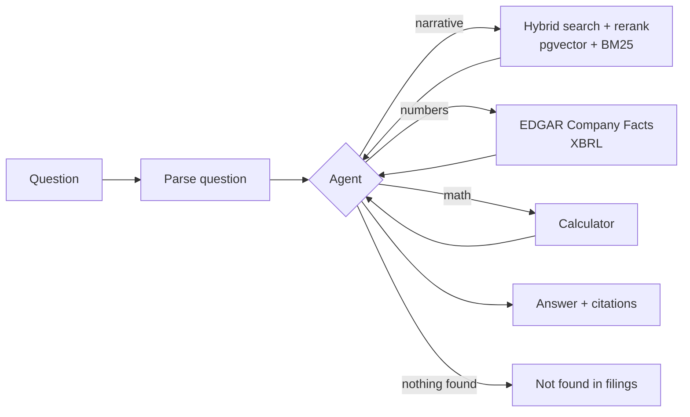

# SEC Filings Research Agent

Ask a question about a public company. Get an answer built from its 10-K and 10-Q filings, with every number and claim cited.

> Status: in progress. Building in public, Oct 2026 – Jan 2027.

## What it does

- Parses a question into structured fields: company, metric, period, question type
- Searches the narrative sections of filings (Item 1 Business, 1A Risk Factors, 7 MD&A) with hybrid search + reranking
- Pulls numbers from the SEC EDGAR Company Facts API (XBRL), never from model memory
- Does math with a calculator tool, not in the model's head
- Cites the filing and section for every claim
- Answers "not found in filings" instead of guessing
- Exposes its tools as an MCP server
- Routes simple questions to a cheap model, hard ones to a strong model

## How it works



## Results

Measured on a hand-verified set of 50+ questions. Filled in as evals run.

| Metric | Baseline | Current |
| --- | --- | --- |
| Retrieval recall@5 | – | – |
| Answer accuracy | – | – |
| Citation correctness | – | – |
| Refusal accuracy | – | – |
| Cost per question | – | – |
| p95 latency | – | – |

## Stack

Python · FastAPI · Postgres + pgvector · Claude + a cheaper model · Cohere/bge reranker · LangGraph · Arize Phoenix · Docker · AWS · Streamlit

## Data

- Filings text: [SEC EDGAR](https://www.sec.gov/edgar/search/)
- Financial facts: [Company Facts API](https://www.sec.gov/search-filings/edgar-application-programming-interfaces), e.g. `https://data.sec.gov/api/xbrl/companyfacts/CIK0000320193.json`

SEC requires a `User-Agent` header with your name and email, and allows up to 10 requests per second.

## Run it

Works from milestone 3 onward.

```bash
git clone https://github.com/satya764/sec-research-agent.git
cd sec-research-agent
cp .env.example .env        # add your API keys and SEC user agent
uv sync
docker compose up
uv run pytest
```

## Build log

Each milestone ships something that works and teaches the skill it needs.

### Milestone 1 · Fetch company facts (week 1–2)
- [ ] CLI: `uv run facts AAPL Revenues` prints revenue by fiscal year
- [ ] Pydantic models for the API response
- [ ] SEC user agent read from `.env`
- [ ] Errors logged, saved to JSON, 3+ tests passing

Learn: Python basics, `httpx`, JSON, Pydantic, pytest, `.env`, logging

### Milestone 2 · Parse questions with an LLM (week 2)
- [ ] Question → `{company, metric, period, type}` as typed JSON
- [ ] Streaming response, retries, token and cost count per call
- [ ] Same prompt run on 3 models, cost compared

Learn: LLM APIs, structured output, tool calling, prompting, token math

### Milestone 3 · Backend and data (week 3)
- [ ] FastAPI + Postgres in Docker, CI green
- [ ] Narrative sections chunked, embedded, stored in pgvector
- [ ] XBRL facts loaded into a Postgres table for 5+ companies

Learn: async, FastAPI, Docker, SQL, embeddings

### Milestone 4 · Retrieval (week 4)
- [ ] `/ask` endpoint with hybrid search, metadata filters, reranking
- [ ] Citations on every answer, refusal when nothing relevant

Learn: BM25, HNSW indexes, reranking, RAG

### Milestone 5 · Evals (week 5)
- [ ] 50+ questions with hand-verified answers
- [ ] Scorecard: vector-only vs hybrid + rerank
- [ ] Evals run in CI on every PR

Learn: golden datasets, recall@k, MRR, LLM-as-judge

### Milestone 6 · Agent (week 6)
- [ ] Own tool-use loop: search, facts, calculator, compare
- [ ] Memory, max steps, guardrails, prompt-injection and PII checks

Learn: agent loops, tool design, guardrails

### Milestone 7 · MCP + LangGraph (week 7)
- [ ] Tools exposed as an MCP server
- [ ] Agent ported to LangGraph, compared with the raw loop

Learn: MCP, LangGraph, multi-agent patterns

### Milestone 8 · Ship (week 8)
- [ ] Live on AWS with a Streamlit UI
- [ ] Phoenix tracing, cost and latency per request
- [ ] Model router, caching, fallback model

Learn: deployment, observability, cost control

## Decisions

| Decision | Why | Alternatives considered |
| --- | --- | --- |
| Numbers from XBRL, not from chunks | Tables split across chunks break the numbers | Parse HTML tables |
| | | |

## What didn't work

Logged as it happens.

## License

MIT
