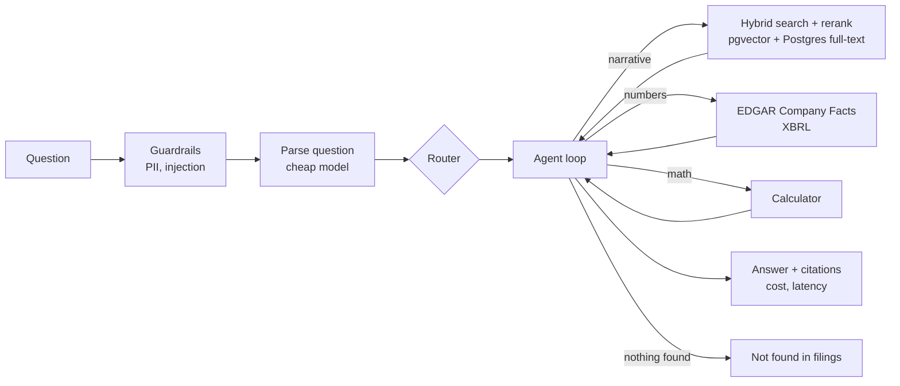

# SEC Filings Research Agent

Ask a question about a public company. Get an answer built from its 10-K and 10-Q filings, with every number and claim cited.

> Status: working end to end on Apple, Microsoft and NVIDIA 10-Ks, runs free on a laptop. Oct 2026 – Jan 2027.

## What it does

- Parses a question into structured fields: companies, metric, fiscal years, question type
- Searches the narrative sections of filings (Item 1 Business, 1A Risk Factors, 7 MD&A) with hybrid search, plus optional Cohere reranking
- Pulls numbers from the SEC EDGAR Company Facts API (XBRL), never from model memory
- Does math with a calculator tool, not in the model's head
- Cites the filing and section for every claim, and flags citations it never retrieved
- Answers "Not found in filings." instead of guessing
- Routes simple questions to a cheap model, hard ones to a strong model, with a fallback model on API errors
- Redacts personal data and blocks prompt injection before anything reaches a model
- Exposes its tools as an MCP server
- Same agent in two versions: a plain tool-use loop and a LangGraph state machine

## How it works



## Results

Golden set: 27 hand-verified questions over the latest Apple, Microsoft and NVIDIA 10-Ks
(21 numeric, 3 narrative, 3 unanswerable). Numbers were checked against each filing's financial statements.

| Metric | Qwen3 8B, local | Claude Haiku | Claude Sonnet |
| --- | --- | --- | --- |
| Answer accuracy | 100% (24/24) | – | – |
| Citation correctness | 100% | – | – |
| Refusal accuracy | 100% (3/3) | – | – |
| Retrieval recall@5 | 100% (3 questions) | – | – |
| Cost per question | $0 | – | – |
| p95 latency | 198 s | – | – |

Hybrid search, no reranker, local bge-small embeddings. Run on a MacBook with Ollama, Oct 26 2026.
Narrative answers are graded on citations only until reference answers are written.

| Run | Answer accuracy | Change |
| --- | --- | --- |
| 1 | 92% (22/24) | baseline |
| 2 | 100% (24/24) | clarified the `value` field in `final_answer` |

Run 1 missed two growth questions: the answer text had the right percent (17.79%, 65.47%),
but the structured `value` field held the revenue instead. The eval reads `value`, not the text,
so it caught a schema bug a human skim would miss.

This set is small and mostly single-company lookups. 100% here means the basics work, not that
the agent is done. Next: harder questions (multi-company comparisons, 3-year trends, 10-Q data).

## Stack

Python 3.13 · FastAPI · Postgres + pgvector · Claude Haiku/Sonnet or local Qwen3 via Ollama · local bge-small embeddings (fastembed) · Cohere rerank · LangGraph · MCP · Arize Phoenix · Docker · Streamlit · GitHub Actions

## Run it

You need: [uv](https://docs.astral.sh/uv/) and Docker. Everything can run free on your machine: embeddings with fastembed, answers with [Ollama](https://ollama.com). Claude (more accurate), Cohere and OpenAI are optional, set in `.env`.

Free local model (once):

```bash
ollama pull qwen3:8b
printf 'FROM qwen3:8b\nPARAMETER num_ctx 16384\n' > Modelfile   # default 4K context is too small for the agent
ollama create qwen3-16k -f Modelfile && rm Modelfile
```

```bash
cp .env.example .env          # set SEC_USER_AGENT and pick a model block (local or Claude)
uv sync --all-extras          # installs everything, updates uv.lock
uv run pytest                 # unit tests, no keys needed

# 1. Numbers only (no database needed)
uv run sec-agent facts AAPL revenue

# 2. Database + filings
docker compose up -d db
uv run sec-agent init-db
uv run sec-agent ingest AAPL MSFT NVDA --limit 1 -v
uv run sec-agent stats
uv run sec-agent search "supplier concentration risk" --company AAPL

# 3. Ask
uv run sec-agent ask "How much did Apple's revenue change from fiscal 2023 to 2024?"
uv run sec-agent ask "What are Microsoft's main risk factors around AI?" --graph

# 4. API + UI
uv run sec-agent serve                 # http://localhost:8000/docs
uv run streamlit run app/ui.py         # http://localhost:8501

# 5. MCP server (for Claude Desktop or any MCP client)
uv run sec-agent mcp
```

Or run the API and database together: `docker compose up --build`.

## Evals

```bash
uv run sec-agent candidates AAPL MSFT NVDA          # drafts numeric questions from XBRL
# open evals/candidates.jsonl, check each number against the filing,
# set "verified": true, and copy the rows into evals/golden.jsonl
uv run sec-agent eval                                # all verified rows
uv run sec-agent eval --limit 5                      # quick check
uv run sec-agent eval --ids msft-revenue-growth-2026 # rerun specific rows
uv run sec-agent eval --mode vector                  # compare retrieval modes: vector, hybrid, hybrid_rerank
```

Only verified rows count. Results go to `evals/results/`. The Evals workflow runs on pull requests
when an `ANTHROPIC_API_KEY` repo secret is set, and fails below 80% accuracy.

## Project layout

```
src/sec_research_agent/
  sec_client.py   EDGAR: ticker lookup, company facts, filing lists, documents (rate limited, cached)
  facts.py        clean annual/quarterly series out of XBRL facts
  filings.py      HTML to text, find Items 1, 1A, 7 (skips the table of contents)
  chunking.py     paragraph -> sentence -> hard-cut chunking with overlap
  embeddings.py   local embeddings (fastembed), OpenAI option, hash embedder for tests
  db.py           pgvector store: vector search, full-text search, metadata filters
  retrieval.py    vector / keyword / hybrid (RRF) / hybrid + Cohere rerank
  llm.py          Claude and OpenAI-compatible (Ollama) clients: cost per call, fallback, structured output
  router.py       cheap vs strong model
  guardrails.py   PII redaction, prompt injection checks
  tools.py        search_filings, get_financial_data, calculator, final_answer
  agent.py        plain tool-use loop
  graph_agent.py  same agent as a LangGraph graph
  api.py          FastAPI: /ask, /facts, rate limit, answer cache, session memory
  mcp_server.py   MCP tools
  evals.py        golden-set evals and candidate generation
  tracing.py      Phoenix tracing (optional)
app/ui.py         Streamlit chat UI
evals/            golden set and results
docs/deploy.md    AWS deployment
```

## Decisions

| Decision | Why | Alternatives considered |
| --- | --- | --- |
| Numbers from XBRL, never from text chunks | Financial tables get split across chunks; XBRL values are exact and tagged | Parse HTML tables |
| Drop numeric tables during ingestion | Keeps chunks narrative; numbers have one source | Keep tables as text |
| Only Items 1, 1A, 7 (10-K) and MD&A / risk factors (10-Q) | These answer descriptive questions; the rest is boilerplate or numbers | Whole filing |
| Longest span per item heading | Every item also appears in the table of contents | First match, regex on TOC page numbers |
| Hybrid search with reciprocal rank fusion | Vector search misses exact terms (product names, "Item 1A"); keyword misses paraphrases | Vector only |
| Local embeddings (bge-small, 384 dims) by default | Free, private, no rate limits; OpenAI stays one setting away for comparison | OpenAI text-embedding-3-small |
| Postgres for vectors and keywords | One database, metadata filters in SQL | Pinecone, Chroma, Elasticsearch |
| `final_answer` as a tool with citation ids | Citations are structured and checkable; unknown ids are flagged | Free-text answers with inline citations |
| `tool_choice: any` | The model must act through tools every turn, so it can't answer from memory | Let the model reply in text |
| Haiku for lookups, Sonnet for multi-step | Most questions are single lookups | One model for everything |
| Model provider is a setting (Claude or any OpenAI-compatible API) | Runs free on a laptop with Ollama; the same evals compare local vs Claude | Claude only |
| Plain loop first, LangGraph second | Shows what the framework adds | Start with a framework |

## What didn't work

- Ollama's default 4K context made the agent loop until the step limit. Fixed with a 16K-context model (`num_ctx 16384`).
- Page footers like "Apple Inc. | 2025 Form 10-K | 11" leak into chunks. Not fixed yet.
- The local model sometimes replies in text instead of calling a tool; the agent nudges it and continues.
- Citation check flagged a correct answer (Microsoft segments): the judge only saw the first 1,000 characters of each passage. Now it sees the full passage.

## License

MIT
